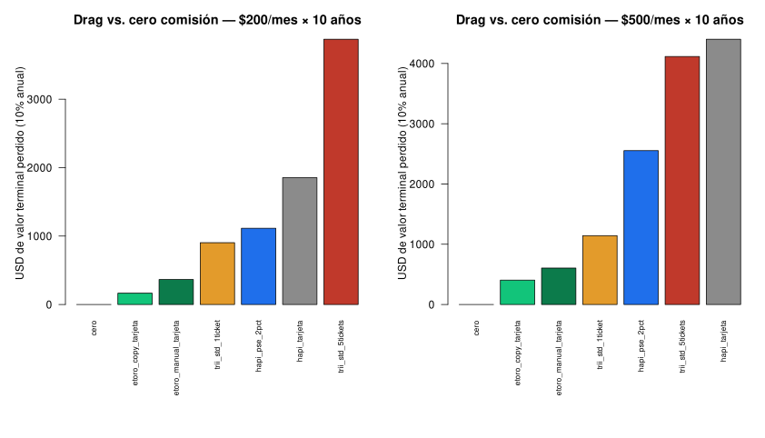

# Comisiones eToro vs Hapi vs Trii — DCA Colombia

Pregunta del caso: **si una persona en Colombia aporta 200 o 500 USD al mes durante 5 o 10 años, al mismo libro de activos, ¿cuánto se come el depósito + el ticket de compra + el GMF + el retiro?**

El rendimiento del mercado se deja **igual en todos los brokers** (10% anual de planificación). Así el diferencial es solo costo. No es un backtest de SPYG/SMH/BRK.B/VTI/IEMG ni una recomendación de plataforma.

Código: [`R/simular_comisiones.R`](R/simular_comisiones.R).

## El libro (mismos pesos)

| Activo | Peso | Tipo en eToro |
|---|---:|---|
| SPYG | 35% | ETF → comisión $0 |
| SMH | 15% | ETF → $0 |
| BRK.B | 20% | acción → ~$1 por compra manual; $0 en CopyTrader |
| VTI | 10% | ETF → $0 |
| IEMG | 20% | ETF → $0 |

Cada mes se compra el libro con el efectivo **neto de costos**. No hay rebalanceo de lo ya comprado ni ventas intermedias.

## Escenarios y tarifas

| Escenario | Depósito | Trading por mes | Retiro final | GMF 4×1000 |
|---|---|---|---|---|
| `etoro_copy_tarjeta` — copiar el portafolio @Andalejo1109, depósito con tarjeta | $0 de eToro | $0 (CopyTrader sin costo extra; sin comisión de acciones) | US$5 | sí |
| `etoro_manual_tarjeta` — mismo libro, compra manual | $0 de eToro | US$1 por BRK.B; ETF $0 | US$5 | sí |
| `hapi_pse_2pct` — Hapi por PSE | 2% (mín. US$1,99) | 5 × US$0,15 clearing (supuesto) | US$4,99 | sí |
| `trii_std_1ticket` — Trii, una sola orden | $0 | COP 14.875 IVA incl. | — | sí |
| `trii_std_5tickets` — Trii, mismo libro | $0 | 5 × COP 14.875 IVA incl. | — | sí |

**Conversión COP→USD:** la TRM la fija el banco y, como inversores en Colombia, la aceptamos. No se modela ningún diferencial cambiario: FX = 0 en todas las plataformas.

**Hapi 2%:** es un supuesto del caso. La ayuda oficial de Hapi publica hoy **0,45% (mín. US$1,99)** por PSE; con 2% el mínimo ya no domina (US$4 sobre 200, US$10 sobre 500).

**GMF 4×1000:** se aplica al débito de la cuenta bancaria (pago del PSE o de la tarjeta) en todas las plataformas. Si la cuenta está marcada como exenta (Art. 879 ET), el costo baja para todas por igual.

## Supuestos fijos

| Pieza | Valor |
|---|---|
| TRM de trabajo | 4.000 COP/USD |
| Rentabilidad | 10% anual compuesto, constante |
| Aporte | 200 o 500 USD/mes, 5 o 10 años |
| Capital inicial | 0 |
| FX / diferencial TRM | 0 (se acepta la TRM del banco) |
| Spreads / bid-ask | no modelados |
| Inactividad eToro | no aplica (cuenta activa; US$10/mes solo tras 12 meses sin login) |
| Retiro | un único retiro al final del horizonte |

Escenario `cero` = techo teórico (0 costos). Sirve de regla para medir *drag*.

## Resultado — 10 años al 10% (ordenado por costo)

Aportes brutos: **24.000** (200/mes) o **60.000** (500/mes). Terminal sin costos: **39.973** y **99.932**.

| Escenario | 200/mes costos | 200 % aportes | 200 terminal | 200 drag | 500/mes costos | 500 % aportes | 500 terminal | 500 drag |
|---|---:|---:|---:|---:|---:|---:|---:|---:|
| Cero comisión | 0 | 0,00% | 39.973 | 0 | 0 | 0,00% | 99.932 | 0 |
| **eToro copy + tarjeta** | **101** | **0,42%** | **39.808** | **165** | **245** | **0,41%** | **99.527** | **405** |
| eToro manual + tarjeta | 221 | 0,92% | 39.608 | 365 | 365 | 0,61% | 99.327 | 605 |
| Trii estándar, 1 ticket | 542 | 2,26% | 39.070 | 903 | 686 | 1,14% | 98.789 | 1.143 |
| Hapi PSE 2% | 671 | 2,80% | 38.859 | 1.114 | 1.535 | 2,56% | 97.379 | 2.553 |
| Trii estándar, 5 tickets | 2.327 | 9,70% | 36.097 | 3.876 | 2.471 | 4,12% | 95.816 | 4.116 |

A 5 años el orden no cambia (ver `output/resultados_comisiones.csv`).



### Opción de menor costo bajo estos supuestos: eToro copy + tarjeta

Con FX = 0, GMF a todas y un retiro final, **copiar el portafolio en eToro depositando con tarjeta** es el escenario de menor costo a 200 y a 500 USD/mes: el costo total es el GMF + US$5 de retiro. Frente a la compra manual en eToro, se ahorra el US$1 mensual de BRK.B.

> **Nota:** el copy aplica a **quien copia** el portafolio @Andalejo1109. En eToro solo se puede copiar a otros usuarios (Popular Investors); no es posible copiar la cuenta propia. Para el titular, el escenario comparable es `etoro_manual_tarjeta`.

Es un resultado **educativo**, no una recomendación de plataforma ni de inversión. Si el banco cobra recargo por compra internacional, trata el depósito como avance, o Hapi cobra su tarifa publicada (0,45%), el orden puede cambiar.

### Lectura

- El **ticket fijo en COP** de Trii pega más cuando el aporte es chico **y** se parte en varios nombres: 5 tickets se llevan ~9,7% de cada aporte de 200 USD.
- El **2% de Hapi** escala con el aporte: a 500 USD/mes cuesta más del doble que a 200.
- En eToro, el costo de operar este libro es casi irrelevante: US$1/mes por BRK.B en manual, $0 en copy.

## Fuentes (consultadas octubre 2026)

- eToro CopyTrader — sin costo adicional; mínimo US$200 por trader y US$1 por posición: https://www.etoro.com/en-us/copytrader/ · https://www.etoro.com/copytrader/how-it-works/
- eToro tarifas — acciones US$1–2, sin comisión en CopyTrader; retiro US$5 (mín. US$30): https://www.etoro.com/trading/fees/
- eToro conversión — COP sin tarifa de tarjeta en la tabla: https://www.etoro.com/trading/fees/conversion/
- eToro inactividad US$10/mes tras 12 meses sin login: https://www.etoro.com/wp-content/uploads/2025/01/Cost-and-Charges-examples-table.pdf
- Hapi PSE 0,45% (mín. US$1,99): https://help.hapi.trade/es/articles/10244515-depositar-a-hapi-desde-colombia · https://help.hapi.trade/es/articles/8976002-cuales-son-las-comisiones-y-tarifas-de-hapi
- Hapi retiro US$4,99; Trii ticket COP 14.875: https://economiasantander.com/noticias/invertir-bolsa-plataformas-comparadas-trii-hapi-etoro-tyba/
- GMF — base gravable incluye el IVA: https://normograma.dian.gov.co/dian/compilacion/docs/oficio_dian_14562_2015.htm
- IVA en servicios financieros (Art. 486-1 ET): https://estatuto.co/486-1

## Cómo correrlo

```bash
Rscript R/simular_comisiones.R
```

Salida:

- `output/resultados_comisiones.csv` — grilla 5/10 años × 200/500
- `output/tabla_10anios.csv`
- `output/drag_10anios.svg` (en el repo) y `output/drag_10anios.png` (local)

Para cambiar TRM, tarifas o rentabilidad, editar el bloque de parámetros al inicio del script.

## Disclaimer

Ejercicio ilustrativo con tarifas y una TRM de trabajo. Las comisiones cambian. Rentabilidades pasadas o supuestos de 10% no predicen resultados. No es recomendación de inversión ni de intermediario. Invertir en acciones y ETF implica riesgo de pérdida de capital.

— Andrés Alejandro Rodríguez Lozano
